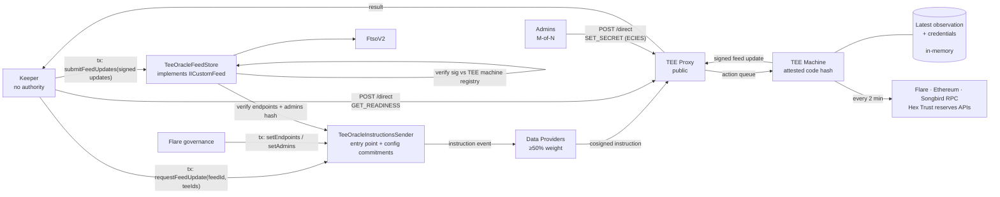
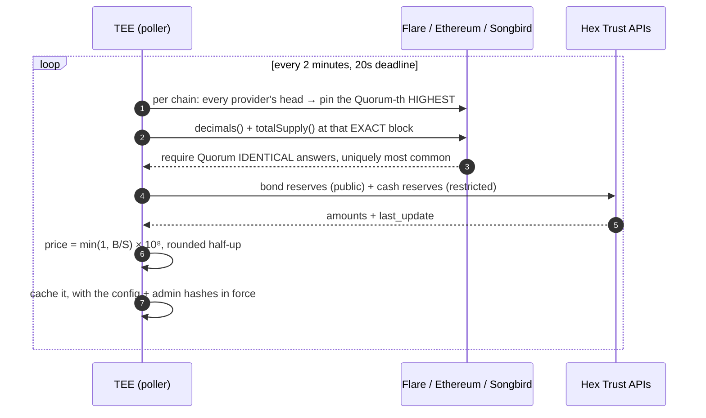
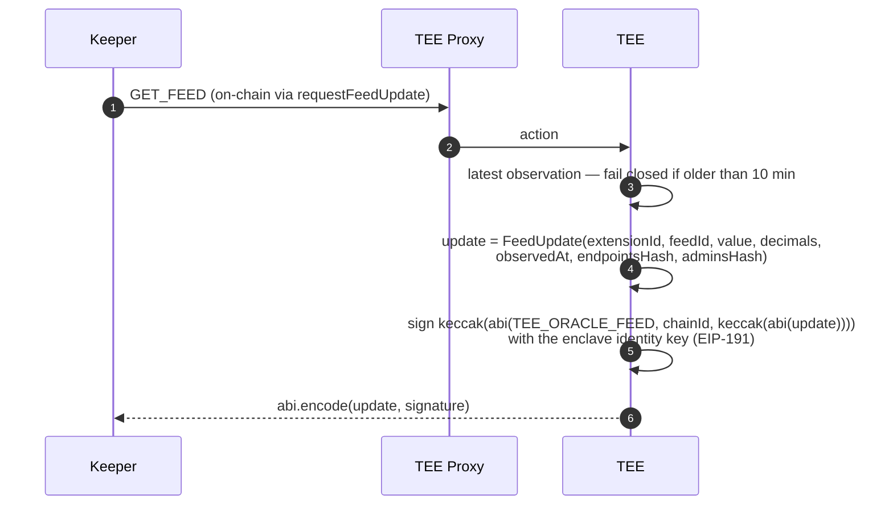
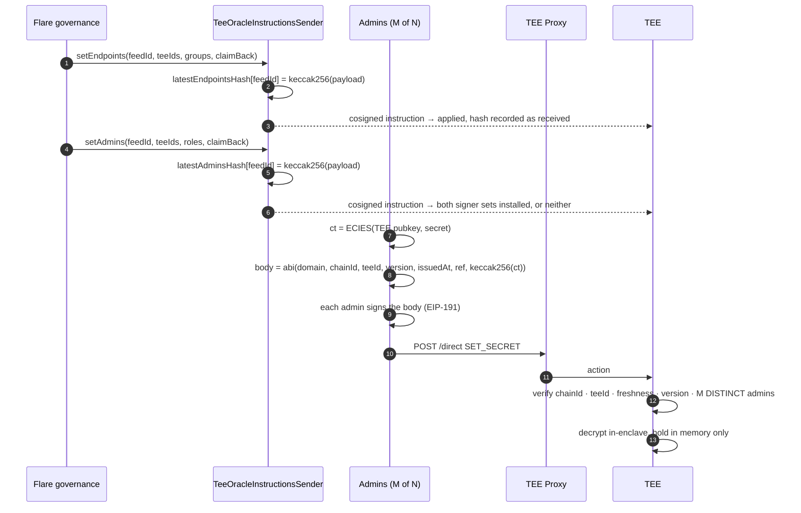

# USDX Price Oracle on Flare

> A reference **data oracle** for **Flare Confidential Compute (FCC)**. USDX has no working market venue, so there is no market price to feed into FTSO. This extension computes one from collateralisation instead — reading supply across three chains and reserves from two Hex Trust APIs inside a TEE — signs it with the enclave's identity key, and publishes it as an FTSO custom feed that anyone can verify without trusting the operator.

This repository is aimed at teams evaluating FCC for **off-chain data that has to be trustworthy**: price feeds, proof-of-reserve, attestations over private APIs, anything where the interesting question is not "who computed this" but "what computed this, and from what". The example is deliberately complete — a live testnet feed, an in-enclave provisioning path for credentials that never touch the chain, a keeper with no authority, and a store contract that refuses anything it cannot pin to a registered machine.

```
supply  = USDX totalSupply() on Flare + Ethereum + Songbird
backing = bond reserves (Hex public API) + cash reserves (Hex restricted API)
price   = min(1, backing / supply)        capped at par: USDX redeems at $1
```

---

## TL;DR

- **A price nobody in the delivery path can alter.** The computation runs inside a TEE pinned by a code hash registered on-chain. The keeper that relays the result holds *no authority* — the `TeeOracleFeedStore` verifies the enclave's signature against Flare's TEE machine registry (the signer must be a registered PRODUCTION machine on the extension), so a compromised keeper costs gas, not correctness, and anyone may submit.
- **Credentials reach the enclave without ever touching the chain.** The restricted reserves API key and the keyed RPC credentials arrive ECIES-encrypted over the direct channel, authorised by *M-of-N admin signatures* published on-chain as addresses. They live in memory only and die with the process.
- **Fail closed, always.** A source down, a value implausible, an observation older than 10 minutes: publish nothing and let the on-chain timestamp age. A frozen feed is the designed failure mode. **Consumers must check the timestamp** — the feed cannot revert, because `FtsoV2` forwards the call and a revert would take down every consumer at once.
- **Every published price commits to the configuration it was computed under.** The signed report carries the hash of the endpoint config *and* the admin set the machine was running, and the store rejects any report whose hashes are not the ones governance published for that machine.

---

## Why build this on FCC?

An oracle over private, unverifiable sources is normally a promise: a server reads an API, signs a number, and you trust the team. Publishing the code doesn't help — nothing proves *that* code produced *this* number. The alternatives are worse: put the API key on-chain and it is public; aggregate over many operators and you have merely spread the same promise around.

FCC collapses the question from "do I trust the operator" to "do I trust the code hash and the registry that admits it". Three concrete properties fall out of this repo:

1. **What computed the price is verifiable; the operator is not in the trust path.** The signing key never leaves attested hardware, and the store admits a signature only from a machine currently registered to this extension and in `PRODUCTION` status — which transitively pins the attested code hash.
2. **The private input stays private and still counts.** The restricted cash-reserves figure is fetched inside the enclave with a credential the enclave alone can decrypt. It moves the published price without ever being published — and `GET /state`, `ActionResult.Log` and every error path are held to a closed vocabulary precisely so it cannot leak by accident.
3. **Configuration is a governed, on-chain fact.** Which RPC providers a machine reads, and who may install credentials in it, are published by transaction and enforced *by the store at submission time*. A machine running a stale configuration cannot publish at all.

**The honest caveat, stated up front:** `setEndpoints` has no host allowlist, so whoever publishes the endpoint configuration — Flare governance, through the sender's `onlyGovernance` guard — chooses the RPC sources and is therefore **price-controlling alongside the code hash**. That is a deliberate trade — pinning provider URLs in the build would mean a code-hash rollout every time an endpoint died — and it is written up in [findings §15](docs/usdx-oracle-findings.md). The Hex reserve URLs *are* pinned in the build, because redirecting them would hand an operator the numerator.

---


## Architecture



Two ways into the TEE, and the choice of channel is a security control rather than a convenience:

| Direction | Channel | Used for |
|---|---|---|
| In (on-chain) | `TeeOracleInstructionsSender` → data providers → proxy → TEE | `SET_ENDPOINTS`, `SET_ADMINS` — authorised by the sender's `onlyGovernance` check. `GET_FEED` — the permissionless path, and the only one it accepts |
| In (off-chain) | Client → proxy → TEE (a "direct action") | `SET_SECRET` — a ciphertext on-chain would be permanent and public. `GET_READINESS` — a status answer stale within minutes is not worth a fee |
| Out | TEE → proxy → keeper → chain | `submitFeedUpdates(SignedFeedUpdate[])` — anyone may relay the machines' signed updates; the store takes the median |

All five commands share the one `TEE_ORACLE` op type; accepting a command over the wrong
channel would bypass its authorisation, so each one states its own guard and is pinned to
exactly the channels it is valid over. `GET_FEED` is instruction-only: it is authorised by
nothing because it *grants* nothing — it signs an observation the enclave already made on its
own timer — but a direct-channel copy would be a fallback path nobody notices has broken.

---

## How it works

### 1. Observation runs on a timer, not per request

This is the single most load-bearing shape in the codebase, and it exists because of something that broke. tee-node allows an extension **2 seconds** to answer an action, and a full observation measures 2.0–2.9 s. Every request timed out until the two were split.



Four details in there are each a fix for a real failure:

- **The Quorum-th highest head, not the minimum.** The minimum is the block every responding provider can serve, which is the right instinct and the wrong rule: one provider answering "what block are you at?" with a number from two weeks ago dragged the minimum back with it, and then every *honest* provider answered the supply query at that old block identically and correctly. Quorum passed. The enclave signed a stale supply. The sharp part is that the malicious provider never lies about the supply — it lies about which question to ask, and the honest majority corroborates the answer. Rewinding to when supply was lower understates supply, which **overstates** the price.
- **A `MaxBlockAge` on the block's own header timestamp.** Head selection cannot help a chain with a single provider. This can: it refuses a pinned block whose *own* timestamp is too far behind wall-clock, and that timestamp is itself agreed by a quorum, so a liar cannot pair an ancient block number with a fresh stamp.
- **The winning answer must be *uniquely* most common.** Reaching the threshold is not enough: a 2–2 split at quorum 2 would otherwise be broken by the order providers happen to be listed in, and the same disagreement would publish either of two supply figures depending on that order. A tie fails closed.
- **`decimals()` is read every time.** USDX is 6 decimals on Flare and Songbird but **18** on Ethereum. Assuming a value would misprice a chain by 10¹².
- **Comma grouping is validated, never stripped.** Hex's two endpoints format differently (`"25,452,544.52"` and `"205304.47"`). Stripping every comma would silently turn a European `"1,50"` into `150` — a hundredfold overstatement of reserves, publishing `$1.00` straight through a real depeg.

**Staleness is bounded on the observation, not on the reserve figure.** A cached observation older than 10 minutes is refused, so past that the extension publishes nothing and the on-chain price ages visibly. Hex's `last_update` gets no such bound, deliberately: both endpoints republish within ~10 minutes of an on-chain event — a mint or a redemption — and never on a schedule, so an old stamp means nothing changed, not that anything is wrong. Bounding it rejected correct figures at a rate set by USDX trading activity, and it never covered the dangerous direction anyway: a frozen upstream shows up as `R` falling behind a growing `S`, which prints *below* par. Only a `last_update` in the **future** is refused, as clock skew or a broken upstream.

### 2. A request costs exactly one signature



Nothing is resampled at signing time, which would put a fresh timestamp on stale inputs. The
`extensionId` and `feedId` bind the update to one feed served by one extension, and `chainId`
is signed too, so it can never be replayed onto another feed or another chain; `observedAt` is
the store's monotonicity key; the two hashes commit the value to the configuration and admin
set in force *when the inputs were read*.

A missing cash figure does not stop the feed — but it can never change the number. Cash is non-negative and the price caps at par, so a bonds-only price that already reaches par *is* the full result. Below par it fails closed rather than publishing a degraded figure.

### 3. Provisioning — the part worth stealing

The extension boots **unprovisioned**, and that is the normal state after every restart. Three things arrive afterwards, and they are deliberately not the same kind of thing.



- **`SET_ENDPOINTS`** decides which RPC sources a machine reads. Instruction-only, because its authorisation *is* the `onlyGovernance` check in the sender.
- **`SET_ADMINS`** decides who may put credentials in the machine. Also instruction-only, and it publishes **two** signer sets — `backing` governs the pinned Hex API key (1-of-N is allowed: a wrong value degrades the feed rather than moving the price), `providers` governs every RPC credential (2-of-N minimum: those get substituted into URLs governance chose). Which set governs which credential is pinned **in the build**, never read from the payload — otherwise whoever publishes admins could move a credential under whichever set they happen to hold.
- **`SET_SECRET`** carries the credential itself. Direct-only. Every rejection returns the same error, so the endpoint cannot be used to probe the admin set or the freshness window.

All three are memory-only. For admins that is load-bearing rather than incidental: a restarted machine fails closed on `SET_SECRET` until `SET_ADMINS` is republished, so there is no window in which a first-come envelope could claim the enclave.

`GET_READINESS` is the fourth direct command — the machine's own account of itself, **signed**, so it means "the enclave says so" rather than "whatever answered that port says so". It is what a keeper checks before paying a registry fee for a request a stale machine would refuse.

### 4. Relay and acceptance

The keeper requests, polls every addressed machine, decodes each signed update, preflights the batch against every store guard, and submits the updates that agree on `observedAt` in one `submitFeedUpdates` call. It holds no authority and it is not allowed to compute or adjust anything — each signed update is relayed as signed, and the store takes the median.

`TeeOracleFeedStore.submitFeedUpdates` then judges the batch: it carries at least `requiredSignatures` updates and at most 32, all stamped with one `observedAt`, and the two values bracketing their median lie within the governance-set spread bound · that `observedAt` strictly increases and is strictly older than the accepting block · every signature verifies through `Fdc2Verification` — each signer is a distinct, registered `PRODUCTION` machine on **this** extension, and the extension is not emergency-paused · every update names the store's extension id and feed id and carries the `endpointsHash` and `adminsHash` the sender currently publishes for the feed (`latestEndpointsHash` / `latestAdminsHash`). The median is stored, and machines whose value lay beyond the bound are named in a `FeedOutliers` event. There are no price bounds and no maximum-age window: acceptance is anchored by the signatures, the commitments, agreement and monotonicity alone.

Strictly increasing `observedAt` is what makes replay and out-of-order delivery harmless in a fire-and-forget system. With two or more keepers, exactly one submission wins per cycle and the losers report `NotNewer` — **that is success, not an alert**.

The store keeps no per-machine bookkeeping: one global `observedAt` stamp is all it holds, and the `FeedUpdated` event's `teeIds` list says which machines contributed. The feed's latest published configuration lives on the sender (`latestEndpointsHash` / `latestAdminsHash` plus versions, per feed), and `isTeeIdConfigured(feedId, teeId)` says whether a machine has been sent it; what a machine is *running* shows up when its updates pass the store's commitment checks — `fleet-status` reconciles the two.

---

## Security model

**What the TEE guarantees**

- **Code attestation.** Every signed price comes from a binary whose code hash is registered on-chain. Changing the price definition, the chain set, the token addresses, the Hex URLs or any deadline requires registering and rolling out a new hash — a visible, governable event, because all of those are compiled in.
- **Consensus on inbound on-chain instructions.** `SET_ENDPOINTS` and `SET_ADMINS` execute only if cosigned by data providers holding ≥50% of the epoch's weight.
- **Replay protection at every layer.** Domain separators keep price, readiness and provisioning signatures from ever being confused for one another. Provisioning envelopes are bound to one chain id, one machine and one ref, with a strictly increasing version and a one-hour freshness window. On-chain, `observedAt` must strictly increase.
- **Credential confidentiality.** Secrets are ECIES-encrypted to the machine's key, decrypted only inside the enclave, held in memory, and never logged, wrapped into an error, or returned. `failure.Failure` has unexported fields and no exported constructor, so the compiler — not review — keeps runtime data out of the world-readable `ActionResult.Log` and `GET /state`.
- **Nothing operator-supplied reaches a public surface.** RPC provider names are positional (`rpc_flare_1`); backing source names are rejected at construction if they look like a URL; readiness names secret *refs*, never values.

**What it does not guarantee**

- **Input provenance.** Consumers verify *what* computed the price, not where its inputs came from. `setEndpoints` has no host allowlist, so whoever publishes the endpoint configuration — Flare governance — is price-controlling alongside the code hash ([findings §15](docs/usdx-oracle-findings.md)).
- **Ordering.** FCC is explicitly fire-and-forget. Two actions submitted in quick succession may arrive in either order; the design assumes it throughout.
- **Liveness.** The public proxy can delay or drop actions, and a sustained outage freezes the feed. That is the designed failure mode, not a fault — which is exactly why consumers must check the timestamp.
- **Hardware trust.** If a TEE vendor is compromised or the attestation chain breaks, the code-hash guarantee collapses. Mitigated operationally, not by FCC.
- **Target binding.** The signed update names the extension id and the feed id (and the chain id), so it cannot be replayed onto another feed or another chain — but a second store registered for the *same* feed under the same extension would still accept it. Accepted trade-off, [findings §18](docs/usdx-oracle-findings.md).
- **Clock independence.** `observedAt` is a global ratchet across machines: one enclave with a fast clock suppresses the others until chain time catches up.

Two more worth knowing before you touch anything: **stub mode is indistinguishable from a healthy fully-backed feed** on the wire (both print `$1.00000000` — `Extension.StubMode()` is what tells them apart), and **`/state` counters describe prices served, not the poller** — a machine nobody queries reports zeroes while its observation loop fails every two minutes. Alert on on-chain feed *age*, or query `GET_READINESS`.

---

## Try it locally

The highest-value local test needs no chain, no TEE and no credentials — it runs the real observation path against live Flare, Ethereum, Songbird and Hex:

```bash
cd go && go run ./cmd/mocknode
```

```bash
cd go && go run ./cmd/devserver
```

```bash
./deploy/scripts/set-endpoints.sh deploy/config/endpoints/public-only.json 8099
```

`./deploy/scripts/oracle-observe.sh` runs this whole sequence — mock signing node, dev server, endpoint provisioning, one `GET_FEED` request — and prints the price and per-source health. Healthy output is `lastPrice: "100000000"` with `hex_cash: not_configured`.

For the full stack — redis, proxy and the extension TEE in containers, against a local chain or Coston2 — see [docs/local-stack.md](docs/local-stack.md):

```bash
./deploy/scripts/full-setup.sh
```

---

## Testing

Start with the checks that need no chain. They catch most breakage in seconds:

```bash
go test ./... && (cd tools && go test ./...) && (cd contracts && forge test)
```

- **Unit tests** — `go test ./...` at the repo root and in `tools/`, covering the quorum procedure, price arithmetic, decimal parsing, the provisioning verifier, the wire encodings and the keeper cycle.
- **Contract tests** — `forge test` prints Solidity's own ABI encoding of the wire payloads (endpoints, admins, the signed feed update) into `deploy/testdata/wire/`, which both Go codecs assert against. The structs are imported straight from the upstream `ITeeOracle*` interfaces (see `contracts/`), so the fixtures cannot drift from the ABI the bindings are generated off.
- **Conformance** — `TestConformance` in `internal/extension` replays the golden wire fixtures in `deploy/testdata/conformance/` against a running extension and diffs the responses. No chain, no proxy, no Docker. This is the acceptance test for any new language implementation.
- **On-chain end-to-end** — `./deploy/scripts/oracle-cycle.sh -tee @<machine> --dry-run` preflights the addressed machines without submitting; dropping `--dry-run` drives one full request → sign → relay cycle. To drive the full feed, follow *"Running the USDX oracle end to end yourself"* in [docs/testing.md](docs/testing.md).

Three things that are easy to misread as failures:

| You see | It means |
| --- | --- |
| `NotNewer: the store already holds observedAt=…` | Correct. Strictly increasing timestamps are what make replay and out-of-order delivery harmless. With ≥2 keepers, exactly one submission wins per cycle |
| `attempt 1: proxy returned 404` then success | The result was not in the proxy's storage yet. The bounded poll waited it out |
| Two instructions with the **same** `observedAt` | The observation cache. Both requests signed the same cached observation under different instruction ids |

---

## What's in the repo

| Layer | Where | What |
|---|---|---|
| On-chain entry | upstream `TeeOracleInstructionsSender` (interface `userInterfaces/tee/ITeeOracleInstructionsSender.sol` in flare-smart-contracts-v2) | `requestFeedUpdate` (anyone), `setEndpoints`/`setAdmins` (governance). Also the expected endpoints/admins hashes the store enforces |
| On-chain acceptance | upstream `TeeOracleFeedStore` (interface `userInterfaces/tee/ITeeOracleFeedStore.sol` in flare-smart-contracts-v2) | Every guard that protects the feed — all authority lives here. Implements the FTSO custom-feed interface (`IICustomFeed`) itself and is registered with FtsoV2 directly |
| Observation | `internal/observation/{supply,backing,price,decimal}` | Quorum RPC reads, Hex HTTP reads, the arithmetic, exact money parsing |
| Orchestration | `internal/observation`, `internal/observation/poller` | One observation start to finish; the timer, the cache and the staleness bound |
| Provisioning | `internal/provisioning/{envelope,store}` | M-of-N envelope verification; the only mutable state in the process |
| Wire formats | `internal/wire/{feedupdate,readiness}`, `internal/failure` | The signed payloads, and the closed public error vocabulary |
| HTTP surface | `internal/extension` | `POST /action` routing and `GET /state` |
| Ops CLI | `cmd/usdxprov` | Build / sign / submit a `SET_SECRET` envelope |
| Tooling & keeper | `tools/` | Registration, configuration publication, the keeper cycle, preflight, fleet status. **Language-neutral** — it re-declares the wire layout rather than importing it |
| Conformance | `deploy/testdata/conformance/` | Golden wire fixtures, asserted against any implementation |

The repository root is the Go module: the extension is the repository. `tools/` is a separate module with no dependency on it, so operators and outside users can build the keeper and deployment CLIs without the enclave code.

---

## Further reading

**Start here**

- **[Codebase walkthrough](docs/usdx-oracle-codebase.md)** — what runs where, which package owns what, and every flow end to end. The map for someone seeing this for the first time
- **[Implementation findings](docs/usdx-oracle-findings.md)** — every security issue found while building, each pinned by a named test. Read this before touching the extension
- [Design rationale](docs/usdx-oracle-rationale.md) — *why* the code is shaped this way: the supply quorum, the closed error vocabulary, what is compiled in rather than configurable

**Operating it**

- [Production setup runbook](docs/usdx-oracle-production-setup.md) — configuration on-chain, credentials under two admin sets, and starting the feed. Who holds what, in which order
- [Tooling reference](docs/usdx-oracle-tooling.md) · [Local & Coston2 stack](docs/local-stack.md) · [Machine deployment](docs/deployment-steps.md)
- [Keeper specification](docs/usdx-oracle-keeper.md) — the cycle and its reliability semantics
- [Monitoring](docs/usdx-oracle-monitoring.md) · [Failure modes](docs/usdx-oracle-failure-modes.md) · [Machine lifecycle](docs/usdx-oracle-machine-lifecycle.md) · [Source availability](docs/usdx-oracle-availability.md)
- [Readiness query](docs/usdx-oracle-readiness-query.md) — what a signed self-report does and does not settle

**Reference**

- [Spec](docs/usdx-oracle-spec.md) — price definition, inputs, verified addresses, work packages · [Plan & TODO](docs/usdx-oracle-plan.md) · [Operational flows](docs/usdx-oracle-flows.md) · [Mint/redeem dynamics](docs/usdx-oracle-mint-redeem-dynamics.md)
- [Extension Container Contract](docs/extension-contract.md) — the normative wire and container spec · [Testing Guide](docs/testing.md) · [Reproducibility](REPRODUCIBILITY.md)

---

## Built On

Flare Confidential Compute — see the [FCC overview](https://dev.flare.network/fcc/overview) for the underlying primitives (extensions, signing policies, data providers, attestation, Protocol Managed Wallets).
