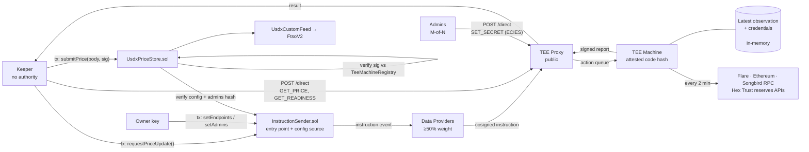
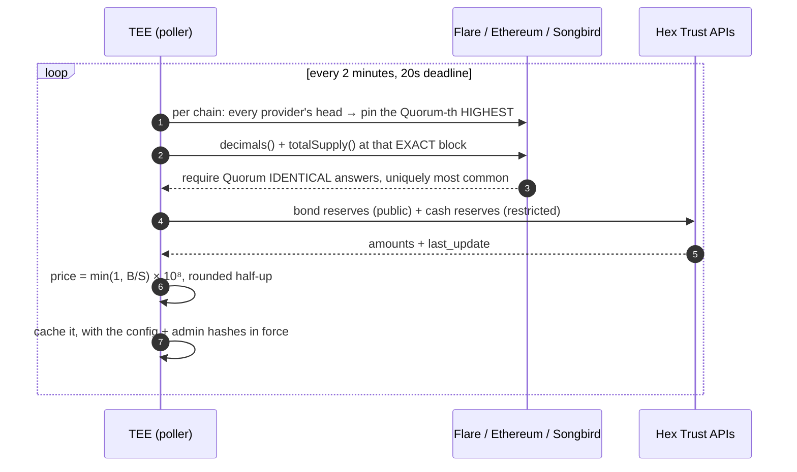
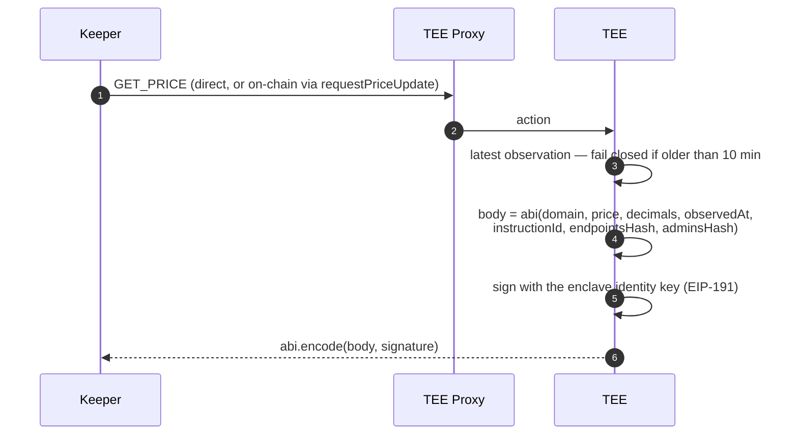
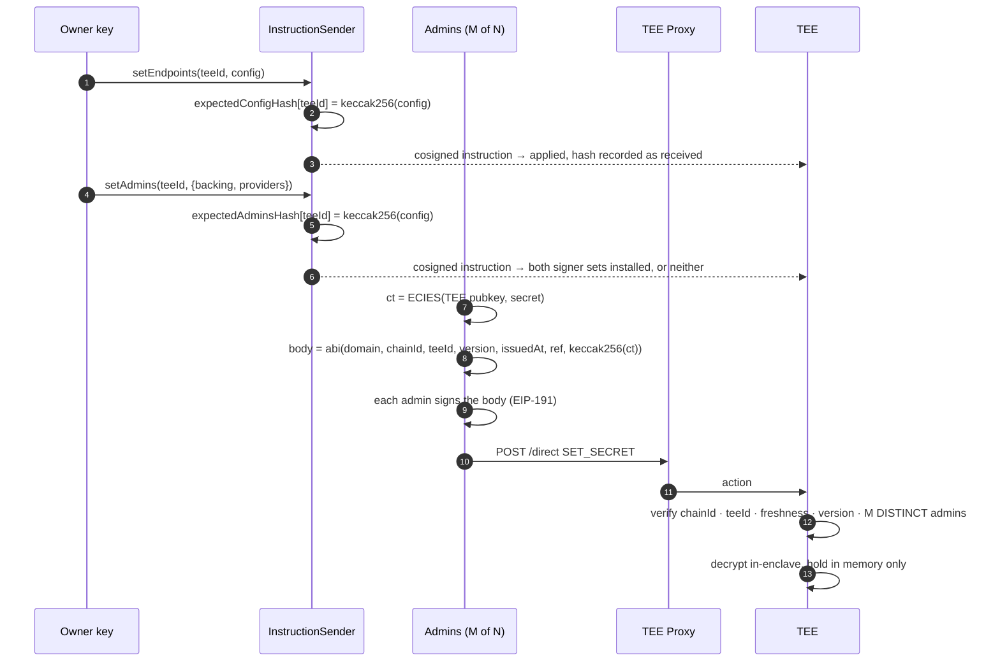

# USDX Price Oracle on Flare

> A reference **data oracle** for **Flare Confidential Compute (FCC)**. USDX has no working market venue, so there is no market price to feed into FTSO. This extension computes one from collateralisation instead — reading supply across three chains and reserves from two Hex Trust APIs inside a TEE — signs it with the enclave's identity key, and publishes it as an FTSO custom feed that anyone can verify without trusting the operator.

This repository is aimed at teams evaluating FCC for **off-chain data that has to be trustworthy**: price feeds, proof-of-reserve, attestations over private APIs, anything where the interesting question is not "who computed this" but "what computed this, and from what". The example is deliberately complete — a live testnet feed, an in-enclave provisioning path for credentials that never touch the chain, a keeper with no authority, and a store contract that refuses anything it cannot pin to a registered machine.

```
supply  = USDX totalSupply() on Flare + Ethereum + Songbird
backing = bond reserves (Hex public API) + cash reserves (Hex restricted API)
price   = min(1, backing / supply)        capped at par: USDX redeems at $1
```

---

## TL;DR

- **A price nobody in the delivery path can alter.** The computation runs inside a TEE pinned by a code hash registered on-chain. The keeper that relays the result holds *no authority* — `UsdxPriceStore` verifies the enclave's signature against Flare's TEE machine registry, so a compromised keeper costs gas, not correctness, and anyone may submit.
- **Credentials reach the enclave without ever touching the chain.** The restricted reserves API key and the keyed RPC credentials arrive ECIES-encrypted over the direct channel, authorised by *M-of-N admin signatures* published on-chain as addresses. They live in memory only and die with the process.
- **Fail closed, always.** A source down, a value implausible, an observation older than 10 minutes: publish nothing and let the on-chain timestamp age. A frozen feed is the designed failure mode. **Consumers must check the timestamp** — the feed cannot revert, because `FtsoV2` forwards the call and a revert would take down every consumer at once.
- **Every published price commits to the configuration it was computed under.** The signed report carries the hash of the endpoint config *and* the admin set the machine was running, and the store rejects any report whose hashes are not the ones governance published for that machine.

---

## Why build this on FCC?

An oracle over private, unverifiable sources is normally a promise: a server reads an API, signs a number, and you trust the team. Publishing the code doesn't help — nothing proves *that* code produced *this* number. The alternatives are worse: put the API key on-chain and it is public; aggregate over many operators and you have merely spread the same promise around.

FCC collapses the question from "do I trust the operator" to "do I trust the code hash and the registry that admits it". Three concrete properties fall out of this repo:

1. **What computed the price is verifiable; the operator is not in the trust path.** The signing key never leaves attested hardware, and the store admits a signature only from a machine currently registered to this extension and in `PRODUCTION` status — which transitively pins the attested code hash.
2. **The private input stays private and still counts.** The restricted cash-reserves figure is fetched inside the enclave with a credential the enclave alone can decrypt. It moves the published price without ever being published — and `GET /state`, `ActionResult.Log` and every error path are held to a closed vocabulary precisely so it cannot leak by accident.
3. **Configuration is a governed, on-chain fact.** Which RPC providers a machine reads, and who may install credentials in it, are published by transaction and enforced *by the store at submission time*. A machine running a stale configuration cannot publish at all.

**The honest caveat, stated up front:** `setEndpoints` has no host allowlist, so the owner key chooses the RPC sources and is therefore **price-controlling alongside the code hash**. That is a deliberate trade — pinning provider URLs in the build would mean a code-hash rollout every time an endpoint died — and it is written up in [findings §15](docs/usdx-oracle-findings.md). The Hex reserve URLs *are* pinned in the build, because redirecting them would hand an operator the numerator.

---

## Live on Coston2

| | |
| --- | --- |
| `UsdxCustomFeed` | [`0x56c5F1b7…a12D`](https://coston2-explorer.flare.network/address/0x56c5F1b72DCA580F7b2B0c07c63973C58627a12D#code) — feed id `USDX/USD`, category 32 — ✅ verified |
| `UsdxPriceStore` | [`0x4E2f462c…73aE`](https://coston2-explorer.flare.network/address/0x4E2f462cfB6CC8567D6A918666B15c04E03B73aE#code) — ✅ verified |
| `UsdxOracleInstructionSender` | [`0x1562e092…a8F6`](https://coston2-explorer.flare.network/address/0x1562e092C807a823fE22dc832b6F20cCe169a8F6#code) — ⚠️ **not verified** |
| Extension id | `66281` (`0x102e9`) |
| Store parameters | bounds `[$0.50, $1.00]` · `maxAge` 3600s · not paused · not invalidated |

```bash
cast call --rpc-url https://coston2-api.flare.network/ext/C/rpc 0x56c5F1b72DCA580F7b2B0c07c63973C58627a12D 'getCurrentFeed()(uint256,int8,uint64)'
```

Returns `(value, decimals, observedAt)` — read it as `value / 10^decimals`, and **always check the age**. It currently returns `100000000, 8` — `$1.00000000`.

The store and the feed are verified, so they can be read from the explorer. The instruction sender is not, and that matters more than it looks: it is the contract holding the owner key that chooses the price sources, so until `./scripts/verify-contracts.sh` covers it, the one component a consumer most needs to audit is the one they cannot read.

> Addresses above are read back from the chain. `config/coston2/deployed-addresses.json` is what the tooling uses — check this table against it after any redeploy, because nothing enforces that the two agree.

---

## Architecture



Two ways into the TEE, and the choice of channel is a security control rather than a convenience:

| Direction | Channel | Used for |
|---|---|---|
| In (on-chain) | `InstructionSender` → data providers → proxy → TEE | `SET_ENDPOINTS`, `SET_ADMINS` — authorised by the sender's owner-only check. `GET_PRICE` also, as the permissionless path |
| In (off-chain) | Client → proxy → TEE (a "direct action") | `SET_SECRET` — a ciphertext on-chain would be permanent and public. `GET_PRICE` and `GET_READINESS` — no fee, no transaction |
| Out | TEE → proxy → keeper → chain | `submitPrice(body, signature)` — anyone may relay a signed report |

Accepting a command over the wrong channel would bypass its authorisation, so each one is pinned to exactly the channels it is valid over. `GET_PRICE` is the deliberate exception, valid over both: it is authorised by nothing because it *grants* nothing — it signs an observation the enclave already made on its own timer.

---

## How it works

### 1. Observation runs on a timer, not per request

This is the single most load-bearing shape in the codebase, and it exists because of something that broke. tee-node allows an extension **2 seconds** to answer an action, and a full observation measures 2.0–2.9 s. Every request timed out until the two were split.



Four details in there are each a fix for a real failure:

- **The Quorum-th highest head, not the minimum.** The minimum is the block every responding provider can serve, which is the right instinct and the wrong rule: one provider answering "what block are you at?" with a number from two weeks ago dragged the minimum back with it, and then every *honest* provider answered the supply query at that old block identically and correctly. Quorum passed. The enclave signed a stale supply. The sharp part is that the malicious provider never lies about the supply — it lies about which question to ask, and the honest majority corroborates the answer. Rewinding to when supply was lower understates supply, which **overstates** the price.
- **A `MaxBlockAge` on the block's own header timestamp.** Head selection cannot help a chain with a single provider. This can: it refuses a pinned block whose *own* timestamp is too far behind wall-clock, and that timestamp is itself agreed by a quorum, so a liar cannot pair an ancient block number with a fresh stamp.
- **The winning answer must be *uniquely* most common.** Reaching the threshold is not enough: a 2–2 split at quorum 2 would otherwise be broken by the order providers happen to be listed in, and the same disagreement would publish either of two supply figures depending on that order. A tie fails closed.
- **`decimals()` is read every time.** USDX is 6 decimals on Flare and Songbird but **18** on Ethereum. Assuming a value would misprice a chain by 10¹².
- **Comma grouping is validated, never stripped.** Hex's two endpoints format differently (`"25,452,544.52"` and `"205304.47"`). Stripping every comma would silently turn a European `"1,50"` into `150` — a hundredfold overstatement of reserves, publishing `$1.00` straight through a real depeg.

**Staleness is bounded on the observation, not on the reserve figure.** A cached observation older than 10 minutes is refused, so past that the extension publishes nothing and the on-chain price ages visibly. Hex's `last_update` gets no such bound, deliberately: both endpoints republish within ~10 minutes of an on-chain event — a mint or a redemption — and never on a schedule, so an old stamp means nothing changed, not that anything is wrong. Bounding it rejected correct figures at a rate set by USDX trading activity, and it never covered the dangerous direction anyway: a frozen upstream shows up as `R` falling behind a growing `S`, which prints *below* par. Only a `last_update` in the **future** is refused, as clock skew or a broken upstream.

### 2. A request costs exactly one signature



Nothing is resampled at signing time, which would put a fresh timestamp on stale inputs. The `instructionId` binds the report to one request; `observedAt` is the store's monotonicity key; the two hashes commit the price to the configuration and admin set in force *when the inputs were read*.

A missing cash figure does not stop the feed — but it can never change the number. Cash is non-negative and the price caps at par, so a bonds-only price that already reaches par *is* the full result. Below par it fails closed rather than publishing a degraded figure.

### 3. Provisioning — the part worth stealing

The extension boots **unprovisioned**, and that is the normal state after every restart. Three things arrive afterwards, and they are deliberately not the same kind of thing.



- **`SET_ENDPOINTS`** decides which RPC sources a machine reads. Instruction-only, because its authorisation *is* the owner-only check in the sender.
- **`SET_ADMINS`** decides who may put credentials in the machine. Also instruction-only, and it publishes **two** signer sets — `backing` governs the pinned Hex API key (1-of-N is allowed: a wrong value degrades the feed rather than moving the price), `providers` governs every RPC credential (2-of-N minimum: those get substituted into URLs the owner key chose). Which set governs which credential is pinned **in the build**, never read from the payload — otherwise whoever publishes admins could move a credential under whichever set they happen to hold.
- **`SET_SECRET`** carries the credential itself. Direct-only. Every rejection returns the same error, so the endpoint cannot be used to probe the admin set or the freshness window.

All three are memory-only. For admins that is load-bearing rather than incidental: a restarted machine fails closed on `SET_SECRET` until `SET_ADMINS` is republished, so there is no window in which a first-come envelope could claim the enclave.

`GET_READINESS` is the fourth direct command — the machine's own account of itself, **signed**, so it means "the enclave says so" rather than "whatever answered that port says so". It is what a keeper checks before paying a registry fee for a request a stale machine would refuse.

### 4. Relay and acceptance

The keeper requests, polls, decodes, preflights every store guard, and submits. It holds no authority and it is not allowed to compute or adjust anything — the signed body is relayed byte for byte.

`UsdxPriceStore.submitPrice` then checks, in order: not paused · 65-byte low-s signature recovering under EIP-191 · signer registered to **this** extension and in `PRODUCTION` · body exactly seven ABI words · domain and decimals · `expectedConfigHash` and `expectedAdminsHash` published *and matching* · `observedAt` strictly greater than stored · not more than 2 minutes in the future · not older than `maxAge` · price inside `[minPrice, maxPrice]`, rejected rather than clamped.

Strictly increasing `observedAt` is what makes replay and out-of-order delivery harmless in a fire-and-forget system. With two or more keepers, exactly one submission wins per cycle and the losers report `NotNewer` — **that is success, not an alert**.

Accepting a report also writes `lastReport[teeId]`: what that machine proved it was *running*, as against the sender's mappings, which record what was *sent* to it. `isProvenConfigured(teeId)` is the difference, and it goes false the moment a new config is published, until that machine lands a price under it.

---

## Security model

**What the TEE guarantees**

- **Code attestation.** Every signed price comes from a binary whose code hash is registered on-chain. Changing the price definition, the chain set, the token addresses, the Hex URLs or any deadline requires registering and rolling out a new hash — a visible, governable event, because all of those are compiled in.
- **Consensus on inbound on-chain instructions.** `SET_ENDPOINTS` and `SET_ADMINS` execute only if cosigned by data providers holding ≥50% of the epoch's weight.
- **Replay protection at every layer.** Domain separators keep price, readiness and provisioning signatures from ever being confused for one another. Provisioning envelopes are bound to one chain id, one machine and one ref, with a strictly increasing version and a one-hour freshness window. On-chain, `observedAt` must strictly increase.
- **Credential confidentiality.** Secrets are ECIES-encrypted to the machine's key, decrypted only inside the enclave, held in memory, and never logged, wrapped into an error, or returned. `failure.Failure` has unexported fields and no exported constructor, so the compiler — not review — keeps runtime data out of the world-readable `ActionResult.Log` and `GET /state`.
- **Nothing operator-supplied reaches a public surface.** RPC provider names are positional (`rpc_flare_1`); backing source names are rejected at construction if they look like a URL; readiness names secret *refs*, never values.

**What it does not guarantee**

- **Input provenance.** Consumers verify *what* computed the price, not where its inputs came from. `setEndpoints` has no host allowlist, so the owner key is price-controlling alongside the code hash ([findings §15](docs/usdx-oracle-findings.md)).
- **Ordering.** FCC is explicitly fire-and-forget. Two actions submitted in quick succession may arrive in either order; the design assumes it throughout.
- **Liveness.** The public proxy can delay or drop actions, and a sustained outage freezes the feed. That is the designed failure mode, not a fault — which is exactly why consumers must check the timestamp.
- **Hardware trust.** If a TEE vendor is compromised or the attestation chain breaks, the code-hash guarantee collapses. Mitigated operationally, not by FCC.
- **Target binding.** A genuinely signed report is replayable into any other store registered under the same extension. Accepted trade-off, [findings §18](docs/usdx-oracle-findings.md).
- **Clock independence.** `observedAt` is a global ratchet across machines: one enclave with a fast clock suppresses the others until chain time catches up.

Two more worth knowing before you touch anything: **stub mode is indistinguishable from a healthy fully-backed feed** on the wire (both print `$1.00000000` — `Extension.StubMode()` is what tells them apart), and **`/state` counters describe prices served, not the poller** — a machine nobody queries reports zeroes while its observation loop fails every two minutes. Alert on on-chain feed *age*, or query `GET_READINESS`.

---

## Try it locally

The highest-value local test needs no chain, no TEE and no credentials — it runs the real observation path against live Flare, Ethereum, Songbird and Hex:

```bash
cd go && go run ./cmd/mocknode
```

```bash
cd go && go run ./cmd/devserver
```

```bash
./scripts/set-endpoints.sh testdata/endpoints/public-only.json 8099
```

Then POST a `GET_PRICE` action. Healthy output is `lastPrice: "100000000"` with `hex_cash: not_configured`.

For the full stack — redis, proxy and the extension TEE in containers, against a local chain or Coston2 — see [docs/local-stack.md](docs/local-stack.md):

```bash
./scripts/full-setup.sh --test
```

---

## Testing

Start with the checks that need no chain. They catch most breakage in seconds:

```bash
cd go && go test ./... && cd .. && ./scripts/test-conformance.sh go && forge test
```

- **Unit tests** — `go test ./...` in `go/` and in `tools/`, covering the quorum procedure, price arithmetic, decimal parsing, the provisioning verifier, the wire encodings and the keeper cycle.
- **Contract tests** — `forge test` drives every `UsdxPriceStore` guard, including the ones easiest to get wrong: unprefixed digests, unnormalised recovery ids, malleable signatures, overlong bodies, and republished configs withdrawing a machine's proof.
- **Conformance** — `./scripts/test-conformance.sh` replays the golden wire fixtures in `testdata/conformance/` against a running extension and diffs the responses. No chain, no proxy, no Docker. This is the acceptance test for any new language implementation.
- **On-chain end-to-end** — `./scripts/test.sh` stops at the proxy, proving the machine produced a valid signed report without putting anything on-chain. To drive the full feed, follow *"Running the USDX oracle end to end yourself"* in [docs/testing.md](docs/testing.md).

Three things that are easy to misread as failures:

| You see | It means |
| --- | --- |
| `NotNewer: the store already holds observedAt=…` | Correct. Strictly increasing timestamps are what make replay and out-of-order delivery harmless. With ≥2 keepers, exactly one submission wins per cycle |
| `attempt 1: proxy returned 404` then success | The result was not in the proxy's storage yet. The bounded poll waited it out |
| Two instructions with the **same** `observedAt` | The observation cache. Both requests signed the same cached observation under different instruction ids |

---

## What's in the repo

| Layer | Where | What |
|---|---|---|
| On-chain entry | `contracts/InstructionSender.sol` | `requestPriceUpdate` (anyone), `setEndpoints`/`setAdmins` (owner). Also the `IUsdxConfigSource` the store reads expected hashes from |
| On-chain acceptance | `contracts/UsdxPriceStore.sol` | Every guard that protects the feed. All authority lives here |
| FTSO adapter | `contracts/UsdxCustomFeed.sol` | Thin `IICustomFeed` read adapter — must never revert |
| Observation | `go/internal/{supply,backing,price,decimal}` | Quorum RPC reads, Hex HTTP reads, the arithmetic, exact money parsing |
| Orchestration | `go/internal/{oracle,observe}` | One observation start to finish; the timer, the cache and the staleness bound |
| Provisioning | `go/internal/{provision,runtimecfg}` | M-of-N envelope verification; the only mutable state in the process |
| Wire formats | `go/internal/{report,readiness,failure}` | The signed payloads, and the closed public error vocabulary |
| HTTP surface | `go/internal/extension` | `POST /action` routing and `GET /state` |
| Ops CLI | `go/cmd/usdxprov` | Build / sign / submit a `SET_SECRET` envelope |
| Tooling & keeper | `tools/` | Deployment, registration, the keeper cycle, preflight. **Language-neutral** — it re-declares the wire layout rather than importing it |
| Conformance | `testdata/conformance/` | Golden wire fixtures, asserted against any implementation |

This repository implements the oracle in **Go only**. The scaffold it derives from supports Python and TypeScript via `LANGUAGE=<dir>`, and the tooling, contracts and conformance harness here are still language-neutral — but no other implementation is checked in, and the fixtures in `testdata/conformance/` are the acceptance test if you add one.

---

## Further reading

**Start here**

- **[Codebase walkthrough](docs/usdx-oracle-codebase.md)** — what runs where, which package owns what, and every flow end to end. The map for someone seeing this for the first time
- **[Implementation findings](docs/usdx-oracle-findings.md)** — every security issue found while building, each pinned by a named test. Read this before touching the extension
- [Design rationale](docs/usdx-oracle-rationale.md) — *why* the code is shaped this way: the supply quorum, the closed error vocabulary, what is compiled in rather than configurable

**Operating it**

- [Production setup runbook](docs/usdx-oracle-production-setup.md) — configuration on-chain, credentials under two admin sets, and starting the feed. Who holds what, in which order
- [Tooling reference](docs/usdx-oracle-tooling.md) · [Local & Coston2 stack](docs/local-stack.md) · [Machine deployment](docs/deployment-steps.md)
- [Keeper specification](docs/usdx-oracle-keeper.md) — the cycle and its reliability semantics
- [Monitoring](docs/usdx-oracle-monitoring.md) · [Failure modes](docs/usdx-oracle-failure-modes.md) · [Machine lifecycle](docs/usdx-oracle-machine-lifecycle.md) · [Source availability](docs/usdx-oracle-availability.md)
- [Readiness query](docs/usdx-oracle-readiness-query.md) — what a signed self-report does and does not settle

**Reference**

- [Spec](docs/usdx-oracle-spec.md) — price definition, inputs, verified addresses, work packages · [Plan & TODO](docs/usdx-oracle-plan.md) · [Operational flows](docs/usdx-oracle-flows.md) · [Mint/redeem dynamics](docs/usdx-oracle-mint-redeem-dynamics.md)
- [Extension Container Contract](docs/extension-contract.md) — the normative wire and container spec · [Testing Guide](docs/testing.md) · [Reproducibility](REPRODUCIBILITY.md)

**Forking this as a template**

- [Extension Development Guide](docs/extension-guide.md) · [Working in Multiple Languages](docs/languages.md) · [Making It Your Own](docs/manual-setup.md) · [InstructionSender Contract](docs/instruction-sender.md)

> The HTML bundle at `docs/usdx-oracle-*.html` is a **stale snapshot** from an earlier design round — it predates the admin-set split, `GET_READINESS`, and the current block-selection rule. Read the Markdown.

---

## Built On

Flare Confidential Compute — see the [FCC overview](https://dev.flare.network/fcc/overview) for the underlying primitives (extensions, signing policies, data providers, attestation, Protocol Managed Wallets).
