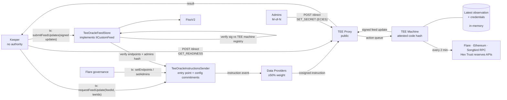

# USDX Price Oracle on Flare

The USDX/USD price feed on Flare, built as a **Flare Confidential Compute (FCC)** extension. USDX
has no working market venue, so there is no market price to feed into FTSO. This extension
computes one from collateralisation instead: it reads supply across three chains and reserves
from two Hex Trust APIs inside a TEE, signs the result with the enclave's identity key, and
publishes it as an FTSO custom feed that anyone can verify without trusting the operator.

```
supply  = USDX totalSupply() on Flare + Ethereum + Songbird
backing = bond reserves (Hex public API) + cash reserves (Hex restricted API)
price   = min(1, backing / supply)        capped at par: USDX redeems at $1
```

The same shape applies to any off-chain data that has to be trustworthy: proof of reserve,
attestations over private APIs, any feed where the question is not who computed a value but what
computed it and from what.

## Architecture



There are two ways into the machine, and the choice of channel is a security control rather than
a convenience. Configuration arrives on chain, cosigned by data providers and authorised by the
sender's governance guard. Credentials arrive off chain over the proxy's direct channel, because
a ciphertext on chain would be permanent and public. Each command is pinned to the channels it is
valid over, so accepting one over the wrong channel cannot bypass its authorisation.

## How it works

**Observation runs on a timer.** A full observation takes longer than the two seconds tee-node
allows an extension to answer an action, so the poller observes every two minutes and caches the
result. Each chain's supply is read at one pinned block agreed by a quorum of providers, and the
reserve figures are read from the two Hex endpoints. The procedure and the failures that shaped
it are in the [design rationale](docs/usdx-oracle-rationale.md).

**A request signs the cached observation.** Nothing is resampled at signing time. The update
carries the extension id, the feed id, the value and its decimals, the observed timestamp, and
the hashes of the endpoint configuration and admin set in force when the inputs were read. The
chain id is signed too, so an update cannot be replayed onto another feed or another chain. An
observation older than ten minutes is refused rather than published.

**Provisioning is memory-only and survives no restart.** The machine boots unprovisioned. Which
sources it reads and who may install credentials in it arrive as governed instructions; the
credentials themselves arrive encrypted to the machine's key, authorised by M-of-N admin
signatures whose addresses are published on chain. See
[production setup](docs/usdx-oracle-production-setup.md).

**The store decides what the feed holds.** It verifies every signature against Flare's machine
registry, checks that each update commits to the configuration the sender currently publishes,
requires one common observed timestamp that strictly increases, and rejects a batch whose values
disagree by more than the governance-set bound. It stores the median. The
[keeper specification](docs/usdx-oracle-keeper.md) covers the cycle that feeds it.

## Trust model

What the design guarantees:

- **The operator is not in the trust path.** The signing key never leaves attested hardware, and
  the store admits a signature only from a machine currently registered to this extension and in
  production status, which transitively pins the attested code hash.
- **Code attestation.** The price definition, the chain set, the token addresses, the reserve
  URLs and every deadline are compiled in, so changing any of them requires registering a new
  code hash, which is a visible and governable event.
- **The relay holds no authority.** Requesting an update and submitting a batch are open to
  anyone with gas, so a compromised keeper costs gas rather than correctness.
- **Configuration is a governed, on-chain fact.** Which sources a machine reads, and who may
  install credentials in it, change only by transaction, cosigned by data providers holding at
  least half the epoch's weight, and are enforced by the store at submission time. A machine
  running a stale configuration cannot publish at all.
- **Credential confidentiality.** A private input moves the published price without ever being
  published itself. Secrets are decrypted only inside the enclave and are never logged, wrapped
  into an error, or returned, and the public error vocabulary is closed and enforced by the
  compiler rather than by review.
- **Replay protection at every layer.** Separate signing domains, per-machine provisioning
  envelopes with a freshness window, and a strictly increasing timestamp on chain.

What it does not:

- **Input provenance.** Consumers verify what computed a price, not where its inputs came from.
  Whoever publishes the endpoint configuration is price-controlling alongside the code hash
  ([findings §15](docs/usdx-oracle-findings.md)).
- **Liveness.** A source outage or a stalled proxy freezes the feed. That is the designed failure
  mode, so **consumers must check the timestamp**: the feed cannot revert, because a revert would
  take down every consumer at once.
- **Hardware trust.** If the attestation chain breaks, the code-hash guarantee collapses with it.

Both reviews of the repository, including the open findings, are in
[security review](docs/usdx-oracle-security-review.md) and
[security review II](docs/usdx-oracle-security-review-2.md).

## Running it

Two directories are involved. [**tools/**](tools/README.md) is the module that operates the
oracle: it registers machines, publishes configuration, installs credentials and runs the keeper
that drives the feed. [**deploy/**](deploy/README.md) sequences those commands into the flows an
operator runs, and covers the test suites, the local simulation, a test deployment on a testnet,
and the production flow for a machine a system administrator operates.

The oracle needs to be deployed as a docker image running inside a TEE machine on a GCP. The only entrypoint
to the oracle, besides testing, is the main `Dockerfile` that builds a reproducible Docker image.

## Repository layout

Four kinds of thing live here, and the split between them is the map.

**The oracle** is the Go module at the repository root. It is what the image ships and what the
code hash attests.

| Where | What |
|---|---|
| `cmd/extension-tee` | tee-node and the extension in one process, the image's only binary |
| `internal/observation` | one observation start to finish: quorum RPC reads, reserve reads, the arithmetic, the timer and the cache |
| `internal/provisioning` | the M-of-N envelope verifier and the credential store, the only mutable state in the process |
| `pkg/protocol`, `pkg/wire` | what the feed is and the payloads it signs: ids, op tags, credential refs, admin roles and chains, and every wire format; the packages the tooling imports |
| `internal/failure` | the closed public error vocabulary |
| `internal/extension`, `pkg/server` | the HTTP surface tee-node drives, and the process that starts it |
| `cmd/dev` | the dev server, the tee-node stand-in and the host-process runner, none of which the image ships |

**Operating it** is [`tools/`](tools/README.md) and [`deploy/`](deploy/README.md). The oracle
does nothing on its own: a machine must be registered, its configuration published, its
credentials installed and its updates requested and relayed, and every one of those is a
transaction or a signed message that somebody has to send. `tools/` is the Go module that sends
them, with the keeper that drives the feed; `deploy/` is the compose stack, the configuration
files and the scripts that sequence the tools into the flows an operator runs.

**Documentation** is [`docs/`](docs/): the specification, the rationale, the findings, the
security reviews and the operator guides, indexed below.

**Testing** has no directory of its own. The Go tests sit beside the code in both modules,
`contracts/` holds the Forge vectors that pin the wire formats in Solidity's own encoding, and
`deploy/testdata/` holds those vectors and the conformance fixtures that any implementation of
the extension is replayed against. [deploy/](deploy/README.md) says how to run each.

The on-chain contracts are upstream's, in `flare-smart-contracts-v2`: the instructions sender is
the entry point, and the feed store holds every guard that protects the feed and implements the
FTSO custom-feed interface itself.

## Documentation

**Start here**

- [Codebase walkthrough](docs/usdx-oracle-codebase.md) — what runs where, which package owns what,
  and every flow end to end
- [Implementation findings](docs/usdx-oracle-findings.md) — every issue found while building, each
  pinned by a named test
- [Design rationale](docs/usdx-oracle-rationale.md) — why the code is shaped this way

**Operating it**

- [tools/](tools/README.md) — the module that operates the oracle · [deploy/](deploy/README.md) — running, testing and deploying · [Tooling reference](docs/usdx-oracle-tooling.md)
- [Production setup](docs/usdx-oracle-production-setup.md) · [Machine deployment](docs/deployment-steps.md) · [Machine lifecycle](docs/usdx-oracle-machine-lifecycle.md)
- [Keeper specification](docs/usdx-oracle-keeper.md) · [Monitoring](docs/usdx-oracle-monitoring.md) · [Failure modes](docs/usdx-oracle-failure-modes.md) · [Source availability](docs/usdx-oracle-availability.md)
- [Readiness query](docs/usdx-oracle-readiness-query.md) — what a signed self-report does and does not settle

**Reference**

- [Specification](docs/usdx-oracle-spec.md) — price definition, inputs, verified addresses
- [Extension container contract](docs/extension-contract.md) — the normative wire and container spec
- [Operational flows](docs/usdx-oracle-flows.md) · [Mint and redeem dynamics](docs/usdx-oracle-mint-redeem-dynamics.md) · [Testing guide](docs/testing.md) · [Reproducibility](REPRODUCIBILITY.md)

## Built on

Flare Confidential Compute. See the [FCC overview](https://dev.flare.network/fcc/overview) for the
underlying primitives: extensions, signing policies, data providers, attestation and Protocol
Managed Wallets.
